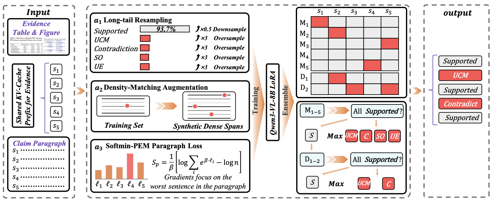
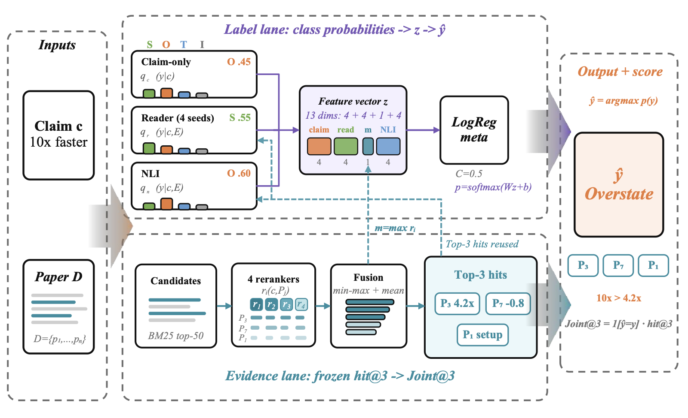

<p align="center">
<h1 align="center">DualFaith</h1>
<h3 align="center">Faithfulness Verification for Scientific Reports against Experimental Results and Citation Evidence</h3>
</p>

<p align="center">
  <b>Wenbiao Zhao<sup>1,*</sup></b>
  &emsp;
  <b>Longkun Shi<sup>1,*</sup></b>
  &emsp;
  <b>Zicheng Zuo<sup>1,2,3</sup></b>
  &emsp;
  <b>Turdi Tohti<sup>1,2,3,&dagger;</sup></b>
</p>

<p align="center">
  <sup>1</sup>School of Computer Science and Technology, Xinjiang University
  <br>
  <sup>2</sup>Joint International Research Laboratory of Silk Road Multilingual Cognitive Computing
  <br>
  <sup>3</sup>Xinjiang Key Laboratory of Signal Detection and Processing
</p>

<p align="center">
  <h3 align="center">
    <a href="https://winbeau.github.io/DualFaith/">Website</a>
    &nbsp;|&nbsp;
    <a href="https://winbeau.github.io/DualFaith/DualFaith-NLPCC2026-Task10-paper.pdf">Paper</a>
    &nbsp;|&nbsp;
    <a href="https://winbeau.github.io/DualFaith/DualFaith-NLPCC2026-Task10-poster-EN.pdf">Poster</a>
    &nbsp;|&nbsp;
    <a href="https://winbeau.github.io/DualFaith/DualFaith-NLPCC2026-Task10-slides.pptx">Slides</a>
    &nbsp;|&nbsp;
    <a href="https://winbeau.github.io/DualFaith/#talk">Talk</a>
    &nbsp;|&nbsp;
    <a href="https://nlp2ct.github.io/NLPCC-2026-Task10-Science/leaderboard.html">Leaderboard</a>
  </h3>
</p>

---

DualFaith is the Team **XJDX_001** system for [NLPCC-2026 Shared Task 10: Reliability of AI-Assisted Scientific Reporting](https://nlp2ct.github.io/NLPCC-2026-Task10-Science/), which asks whether a fluent scientific statement is actually *supported* by its evidence. Track 1 labels each sentence of a results paragraph against the referenced figure or table; Track 2 labels an atomic claim against the full text of the cited paper and returns the supporting paragraphs. The two tracks fail for different reasons, so DualFaith is two specialized pipelines rather than one model: a recall-additive multimodal union ensemble for Track 1, and frozen-evidence label stacking for Track 2. It ranks **1st of 15 teams on Track 2** and **2nd of 11 teams on Track 1**.

<p align="center">
  
  <br><br>
  
  <br>
  <sub><b>Top:</b> Track 1 — multimodal sentence verification. &emsp; <b>Bottom:</b> Track 2 — citation support with frozen evidence.</sub>
</p>

---

## Highlights

- **Recall-additive union ensembling (Track 1).** The official score couples sentence-level Macro-F1 with paragraph exact match, so a single missed minority sentence invalidates an entire paragraph. We fine-tune Qwen3-VL-8B-Instruct with LoRA (`r=16`, `alpha=32`) with the vision tower frozen, and combine five heterogeneous members as a **minority-label union** instead of averaging probabilities. Raising minority predictions from 46 to 399 lifts the Phase-1 score from 18.85 to 50.61 — minority **recall**, not suppression, is the bottleneck.

- **Frozen evidence with domain-robust label stacking (Track 2).** BM25 retrieves candidates; two DeBERTa cross-encoders, MonoT5-large and Qwen3-Reranker-4B are min–max normalized per record and equally fused into a **fixed top-three evidence list**. That list is then frozen, and every later gain comes from the label side: a DeBERTa evidence reader, a claim-only classifier, an external multi-task NLI posterior, and a logistic-regression meta-classifier. Freezing retrieval lets label-side signals correct domain-sensitive errors safely.

- **Negative results reported.** Domain-adversarial training, label-shift correction, extra rerankers, higher image resolution, OCR, supervised chain-of-thought and suppression heuristics all failed to help. The paper documents these alongside the wins.

## Results

**Track 1 — multimodal sentence verification** (top 5 of 11 teams)

| System | Final | Phase 1 | Phase 2 |
|:--|--:|--:|--:|
| SUAT-NLP | **68.90** | **51.85** | 85.95 |
| **DualFaith (XJDX_001)** | 68.79 | 50.61 | **86.97** |
| BIT-TrustAI | 57.99 | 44.09 | 71.88 |
| ZZUNLP_Han | 55.47 | 42.44 | 68.50 |
| YNU-HPCC | 46.16 | 31.93 | 60.39 |

Second by **0.11 points**, with the best Phase-2 score among the top five and the highest Phase-1 Macro-F1 (57.54) of any team.

**Track 2 — citation support** (top 5 of 15 teams)

| # | System | Final | Macro-F1 | Joint@3 | Phase 1 | Phase 2 |
|:--|:--|--:|--:|--:|--:|--:|
| 1 | **DualFaith (XJDX_001)** | **86.27** | 91.18 | **81.37** | **86.21** | **86.33** |
| 2 | Lenormand System | 82.99 | 89.55 | 76.43 | 81.28 | 84.70 |
| 3 | HER-DAC | 81.61 | 93.05 | 70.16 | 81.70 | 81.52 |
| 4 | ZZUNLP_Han | 81.38 | **94.25** | 68.51 | 80.88 | 81.88 |
| 5 | SUAT-NLP | 79.01 | 91.02 | 67.00 | 80.88 | 77.13 |

First by a **3.28-point margin**, almost all of it from Joint@3 (+4.94 over second). Phase 1 and the blind Phase 2 differ by only **0.12** despite the domain shift — Phase 1 is physics- and materials-heavy, while Phase 2 returns to a CS-dominated distribution. For reference, prompting-only baselines reach Phase-1 scores of 40.51 (GPT-5.4), 38.97 (Gemini 3.1 Pro) and 30.35 (Qwen3.6-Plus), well below every fine-tuned submission.

## Materials

| | |
|:--|:--|
| [Paper](https://winbeau.github.io/DualFaith/DualFaith-NLPCC2026-Task10-paper.pdf) | 13 pages, Springer LNCS format |
| [Poster](https://winbeau.github.io/DualFaith/DualFaith-NLPCC2026-Task10-poster-EN.pdf) | A0 portrait |
| [Slides](https://winbeau.github.io/DualFaith/DualFaith-NLPCC2026-Task10-slides.pptx) | 10-minute oral presentation |
| [Talk](https://winbeau.github.io/DualFaith/#talk) | Recording of the oral presentation ([direct MP4](https://winbeau.github.io/DualFaith/DualFaith-NLPCC2026-Task10-talk.mp4)) |

LaTeX sources live in [`paper/`](paper/) and [`poster/`](poster/); [`docs/`](docs/) holds the published site and the built artifacts above.

## Building the Paper and Poster

The paper builds with pdfLaTeX and the poster with XeLaTeX. Both are driven by `latexmk`, which picks up the engine from each directory's `latexmkrc`:

```
cd paper  && latexmk main.tex    # -> main.pdf
cd poster && make                # -> hipm_poster.pdf
```

Note:
* Run `latexmk` **inside** the target directory. `latexmk -cd` reads its configuration from your original working directory rather than the source directory, silently falls back to DVI mode, and then fails to size the PDF figures.
* The poster needs **TeX Gyre Heros**. `fontspec` resolves it by font name, so on macOS it must be installed as a system font — TeX Live's own copy is not visible to Core Text. On Linux, pointing `OSFONTDIR` at the TeX Live font tree is enough.

## Acknowledgements

This work was funded by the Xinjiang Talent Development Fund (Grant No. XJRC-2025-KJ-PY-KJLJ-051). We thank the NLPCC-2026 Shared Task 10 organizers for the task design and evaluation.

## Citation

If you find this work useful for your research, please kindly cite our paper:

```bibtex
@inproceedings{zhao2026dualfaith,
  title     = {DualFaith at {NLPCC}-2026 Task 10: Faithfulness Verification for Scientific Reports against Experimental Results and Citation Evidence},
  author    = {Zhao, Wenbiao and Shi, Longkun and Zuo, Zicheng and Tohti, Turdi},
  booktitle = {Natural Language Processing and Chinese Computing (NLPCC 2026)},
  series    = {Lecture Notes in Computer Science},
  publisher = {Springer},
  year      = {2026},
  note      = {To appear}
}
```

## License

Released under [CC BY 4.0](LICENSE). The paper PDF is the authors' version; the final authenticated version will appear in the NLPCC 2026 proceedings published by Springer.
